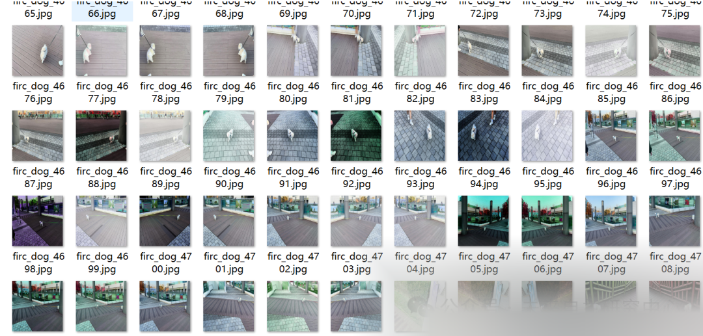
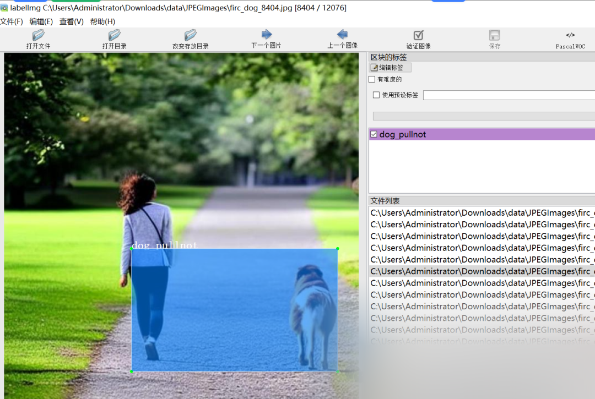

# Detection dataset for walking dogs without leash in VOC+YOLO format with 12076 images in 3 classes

Dataset format: Pascal VOC format + YOLO format (txt file without split path, only containing jpg images and corresponding VOC format xml files and yolo format txt files)

Number of images (number of jpg files): 12076

Number of annotations (number of xml files): 12076

Number of annotations (number of txt files): 12076

Label category count: 3

Label category names: ["dog", "dog_pull", "dog_pullnot"]

Number of boxes labeled in each category:

Dog Frames = 4514

dog_pull frame count = 5227

dog_pullnot frame count = 3562

Total frames: 13303

Using labelImg:

Annotation rules: Draw a rectangle around the category.

Important Notice: No

Special : This dataset does not guarantee the accuracy or precision of the trained models or weight files. The dataset is provided with accurate and reasonable annotations only.

Image Preview:

Annotation example:

## Payment

Here is a pay link on Stripe ( https://buy.stripe.com/3cs8yP7sY87d0vu9AB ). Please contact me lonlonago@foxmail.com after funding $89, and I will send you a complete data files , thank you!

